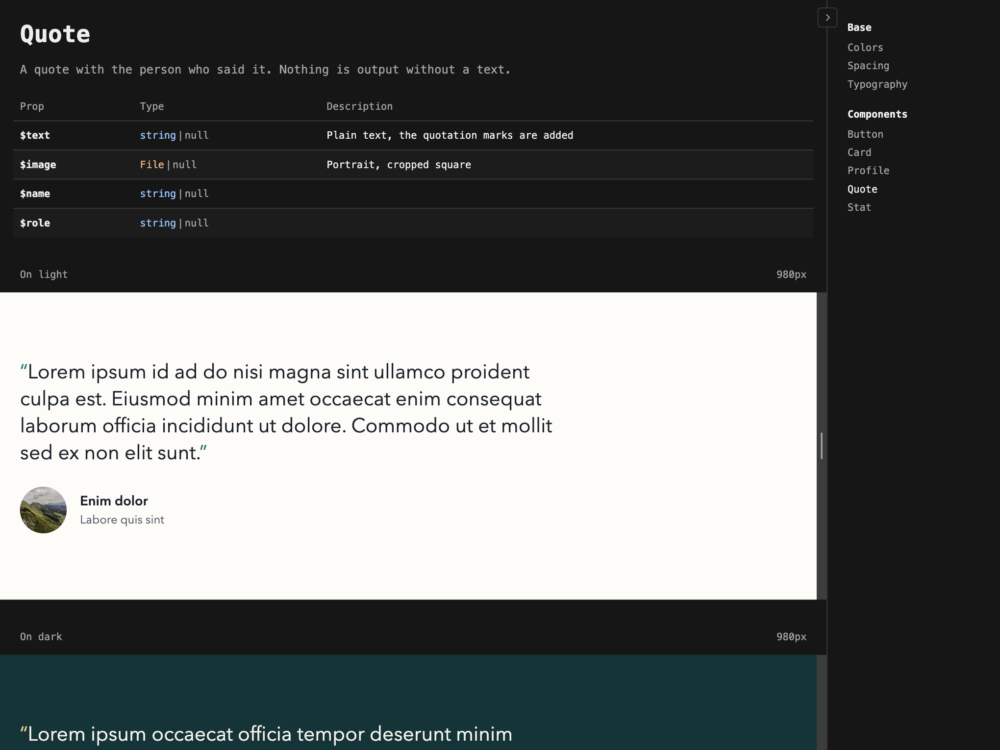
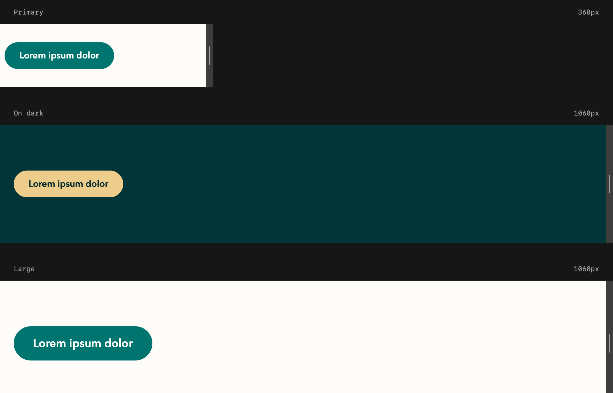
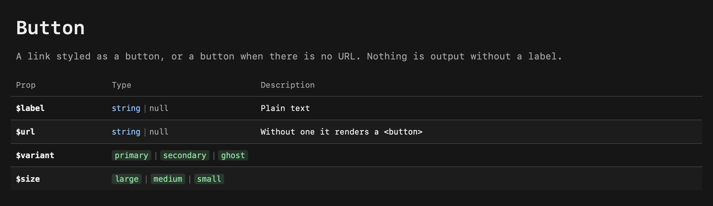
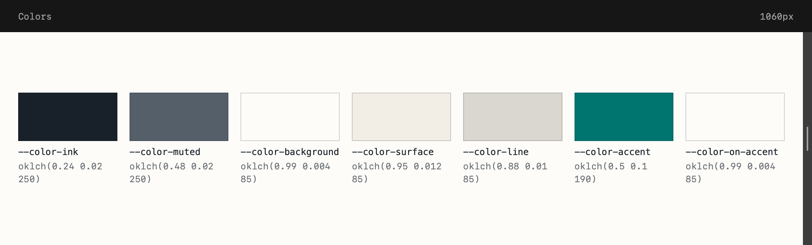
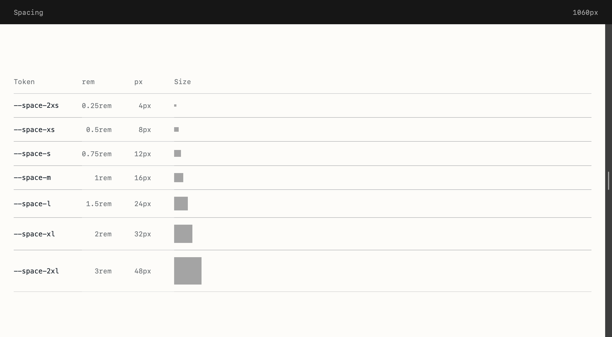
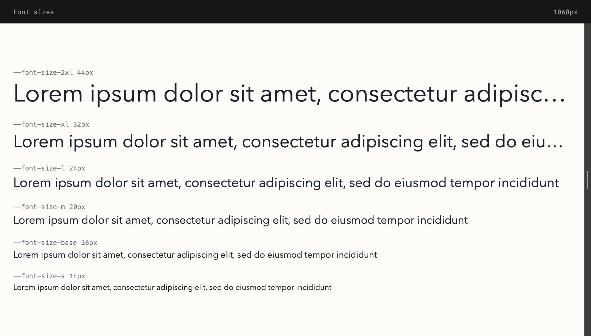
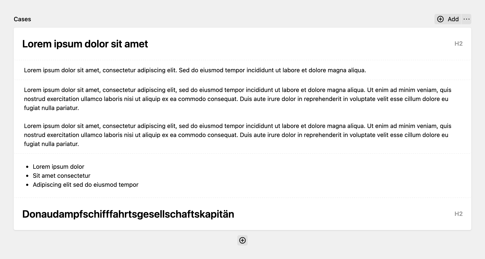
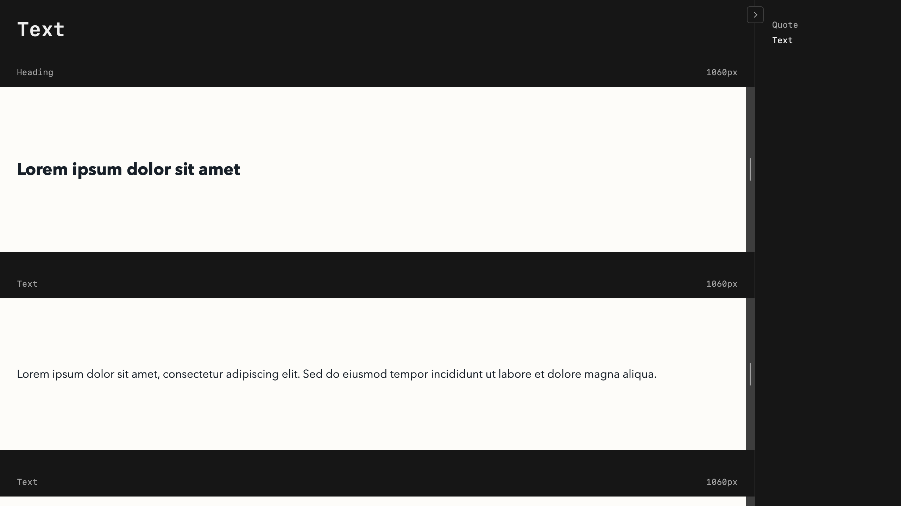

# Kirby Playground



A Kirby plugin that shows your snippets in test cases at `/playground`.

## Usage

Put playground snippets in `site/snippets/playground/`. A snippet `quote.php` is shown at `/playground/quote`, and `/playground` opens the first page.

Subfolders become groups in the sidebar: `form/input.php` is listed under "Form" at `/playground/form/input`. A `base` folder comes first, for pages that are not components, like typography or spacing. The sidebar on the right lists every page and can be collapsed.

## Cases



`Playground::case()` takes a label and a closure that renders the case. Each case gets an anchor and its own iframe, so media queries react to the frame's width. All cases render in the page's request, and the cases show once every frame has its height, so the page doesn't jump while it loads. An error in a case shows in its frame instead of breaking the page. Drag its right edge to resize it; the width shows next to the label.

```php
use Medienbaecker\Playground\Playground;

Playground::case('Primary', fn () => snippet('components/button', ['label' => 'Lorem ipsum dolor', 'url' => '#']));

// Attributes go on the box around the case, e.g. to set a background
Playground::case('On dark', fn () => snippet('components/button', ['label' => 'Lorem ipsum dolor', 'url' => '#']), attributes: ['data-surface' => 'dark']);
```

A case that renders one snippet can use `Playground::component()`:

```php
Playground::component('Large', 'components/button', ['label' => 'Lorem ipsum dolor', 'url' => '#', 'size' => 'large']);
```

Two custom properties set the space around a case. Set them in `assets/css/playground/playground.css` for all cases, or on one case through its attributes:

```css
.playground-ui-case__render {
    --playground-ui-case-padding-block: 5rem;
    --playground-ui-case-padding-inline: var(--spacing-inline);
}
```

```php
Playground::case('Flush', fn () => snippet('components/hero'), attributes: ['style' => '--playground-ui-case-padding-inline: 0']);
```

## Component docs



`playground/button.php` shows the docs of `components/button.php`: the description from its docblock, Markdown allowed, and a table of its `@var` props.

```php
<?php

/**
 * Button
 *
 * A link styled as a button, or a button when there is no URL. Nothing is output without a label.
 *
 * @var string|null $label Plain text
 * @var string|null $url Without one it renders a `<button>`
 * @var 'primary'|'secondary'|'ghost' $variant
 * @var 'large'|'medium'|'small' $size
 */
```

The first line, the name, isn't shown; the page title already says it. To document other snippets, or several, name them in the playground page's docblock with `@component components/<name>`.

## Tokens







Three helpers show custom properties with their computed values. Each takes a label and the property names in the order to show them:

```php
Playground::swatches('Colors', ['--color-ink', '--color-muted', '--color-background', '--color-surface', '--color-line', '--color-accent', '--color-on-accent']);

Playground::sizes('Spacing', ['--space-2xs', '--space-xs', '--space-s', '--space-m', '--space-l', '--space-xl', '--space-2xl']);

Playground::type('Font sizes', ['--font-size-2xl', '--font-size-xl', '--font-size-l', '--font-size-m', '--font-size-base', '--font-size-s']);
```

## Test pages

`Playground::page()` puts any page into the playground's interface. Write the cases in its template, and pass the pages for the sidebar, keyed by heading. The cases can come from content you edit in the Panel, so your blueprints get tested too:



```php
<?php

use Medienbaecker\Playground\Playground;

Playground::page(function () use ($page) {
    foreach ($page->text()->toBlocks() as $block) {
        Playground::case(ucfirst($block->type()), fn () => print $block);
    }
}, ['Tests' => $page->siblings()]);
```



`Playground::page()` writes the whole document, so the template needs nothing else.

When a case brings its own spacing, turn off the space around it in `assets/css/playground/playground.css`:

```css
.playground-ui-case__render:has(> .section) {
    --playground-ui-case-padding-block: 0;
    --playground-ui-case-padding-inline: 0;
}
```

## Placeholder content

The `Placeholder` class makes text and images for playground snippets, or anywhere else:

```php
use Medienbaecker\Playground\Placeholder;
```

### Text

```php
Placeholder::text([
    // word count (default: 20)
    'words' => 50,
    'words' => [30, 60],

    // wrap in <p> tags (default: false)
    'paragraphs' => false,
    'paragraphs' => true,
    'paragraphs' => 3,
    'paragraphs' => [2, 5],

    // insert random <a> tags (default: false)
    'links' => false,
    'links' => true,
    'links' => 2,
    'links' => [1, 3],

    // insert random <strong> tags (default: false)
    'bold' => false,
    'bold' => true,
    'bold' => 1,
    'bold' => [1, 2],

    // insert random <em> tags (default: false)
    'italic' => false,
    'italic' => true,
    'italic' => 1,
    'italic' => [1, 3],

    // swap random words for long German compounds (default: false)
    'long' => false,
    'long' => true,
    'long' => 1,
    'long' => [1, 2],

    // start with (default: 'Lorem ipsum ')
    'prefix' => 'Lorem ipsum ',
    'prefix' => false,

    // end with (default: '.')
    'suffix' => '.',
    'suffix' => false,
])
```

For names or titles, turn off the prefix and suffix to get random words without "Lorem ipsum" and the period:

```php
Placeholder::text(['words' => 5, 'prefix' => false, 'suffix' => false])
```

### Images

Images come from [picsum.photos](https://picsum.photos) as Kirby file objects, so thumbs work:

```php
Placeholder::image('hero')  // shorthand for ['seed' => 'hero']
Placeholder::image(['seed' => 'card', 'width' => 400, 'height' => 300])
Placeholder::image(['id' => 237])  // picsum image ID
Placeholder::image(['seed' => 'hero', 'content' => ['alt' => 'Hero image', 'caption' => Placeholder::text(['words' => 10])]])

Placeholder::images(6, ['seed' => 'gallery'])  // gallery-0, gallery-1, ...

Placeholder::image('hero')->thumb('card')
Placeholder::image('test')->crop(200, 200)
```

Images are downloaded once and cached in `media/playground-source/`; delete that folder to download them again. Images without a seed or ID get one from their position on the page, so they stay the same on every reload.

## Assets

The playground loads these files when they exist:

```
assets/
├── css/
│   └── playground/
│       ├── playground.css
│       └── quote.css
└── js/
    └── playground/
        └── quote.js
```

`playground.css` is loaded on every playground page. `quote.css` is loaded on `/playground/quote` and its cases, `quote.js` only in its cases.

## Configuration

To restrict the playground to logged-in users:

```php
// site/config/config.php
return [
    'medienbaecker.playground.auth' => true
];
```

Playground pages are wrapped in `snippet('head')` and `snippet('bottom')`. If your snippets have other names, override `site/snippets/playground-ui/head.php` and `bottom.php`. The other `playground-ui/*` snippets can be overridden the same way: `layout`, `sidebar` (it gets `$groups`, links keyed by heading), `component`, `case` (it gets `$document`, the frame's document), `frame`, `not-found`, `swatches`, `sizes` and `type`.
